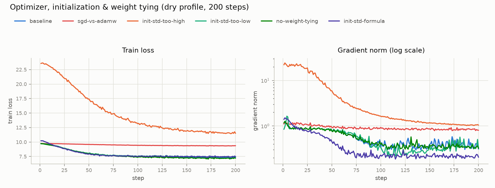
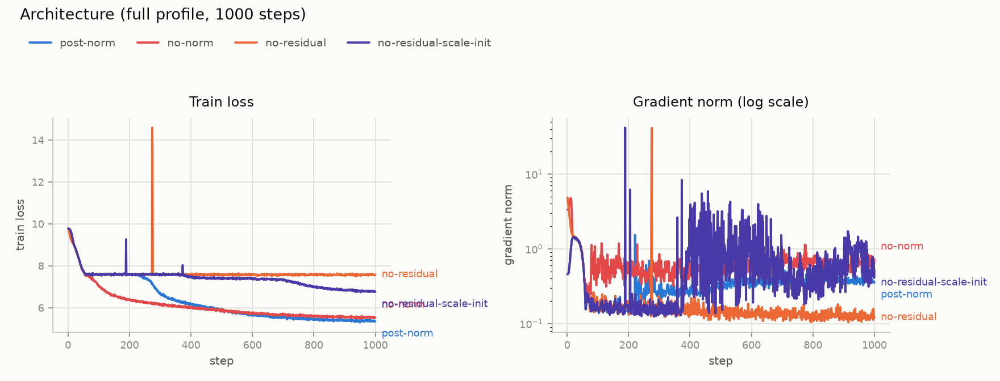
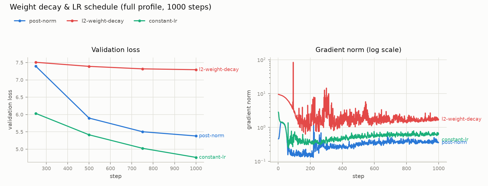
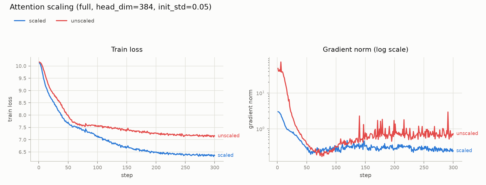
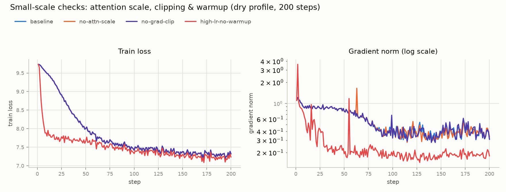
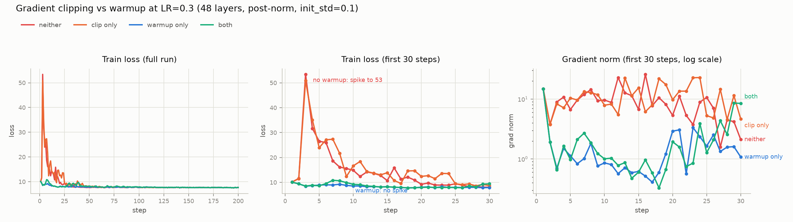

# femtochat: Pretraining Ablation Report

Small-scale experiments on `femtochat`, a from-scratch nanoGPT-style decoder,
reproducing classic LLM pretraining failure modes and tricks. Each run changes
one setting against a matched control; plots are regenerated from the training
event files by `make_figures.py` into `figures/`.

## Setup

Decoder-only transformer — pre-norm residual blocks, tied input/output
embeddings, SDPA attention, learned position embeddings, AdamW, cosine LR decay
— trained on a 10B-token FineWeb-edu sample with a custom 16k-token BPE
tokenizer, locally on an M1 Mac via PyTorch MPS.

| Profile | emb dim | layers | heads | ctx | steps |
|---|---|---|---|---|---|
| `dry` | 128 | 4 | 4 | 256 | 200 |
| `full` | 384 | 8 | 6 | 512 | 1000 |

**Defaults** (one change per experiment unless stated): AdamW, `lr=5e-4`, cosine
decay, warmup (20 `dry` / 100 `full`), `grad_clip=1.0`, `init_std=0.02`,
pre-norm, weight tying on, decoupled weight decay.

**Metrics.** Train loss, gradient norm (the **pre-clip** total norm, so clipped
and unclipped runs stay comparable), and periodic validation loss. No plain
`full` baseline exists; `full` runs are compared against each other, most
usefully against `post-norm` and `constant-lr`.

---

## Optimizer & initialization

Base: `dry` profile.

| Setting changed | train loss | val loss | max grad_norm | Outcome |
|---|---|---|---|---|
| — (baseline) | 7.31 | 7.31 | 1.22 | reference |
| optimizer → SGD | 9.36 | 9.36 | 1.22 | **much slower** convergence at the same LR |
| `init_std` → 0.5 | 11.50 | 11.56 | 24.2 | **severe**: starts at loss 23.6, still 11.5 after 200 steps |
| `init_std` → 0.002 | 7.50 | 7.49 | 1.64 | mildly worse |
| `init_std` → 1/√128 = 0.088 | 7.49 | 7.49 | 1.51 | **no better** than 0.02 |
| untie input/output embeddings | 7.22 | 7.21 | 1.27 | negligible |

`init_std=0.5` saturates the pre-softmax logits and never recovers. Shrinking
init costs ~0.18 loss (`0.002` and `1/√emb_dim` = `0.088` both lose to the flat
`0.02`), so the GPT-2 flat value sits well at this width. Optimizer choice is
worth ~2 loss (SGD vs AdamW); weight tying is worth nothing.

## Architecture

Base: `full` profile.

| Setting changed | train loss | val loss | max grad_norm | Outcome |
|---|---|---|---|---|
| no residual connections | 7.58 | 7.57 | 41.3 | **confirmed**: plateaus at ~7.57 from step 300 through 1000 |
| no normalization | 5.53 | 5.55 | 4.78 | trains, but highest gradient norm of the group |
| post-norm placement | 5.35 | 5.38 | 1.53 | fine at 8 layers — in fact the best loss here |
| post-norm + `residual_scale_init=False` | 6.78 | 6.78 | 41.8 | **invalid** — duplicate of the post-norm run (below) |

`no-residual` caps at ~7.58 by step 300 and never improves over the remaining
700 steps — the model stops learning, exactly what residuals prevent. `no-norm`
trains but sits at the top of the gradient-norm band; post-norm at 8 layers
shows no penalty.

**Known issue.** The `no-residual-scale-init` entry was a no-op:
`residual_scale_init=False` is already the default, so its flags match the
post-norm run's exactly (confirmed in both saved configs); its 5.35 vs 6.78 gap
is run-to-run variance (a gradient spike of 41.8), not an ablation effect.

## Weight decay & LR schedule

Base: `full` profile.

| Setting changed | train loss | val loss | max grad_norm | Outcome |
|---|---|---|---|---|
| weight decay → L2-in-loss | 7.69 | 7.29 | 84.1 | **confirmed**: far higher gradient norm than decoupled decay |
| LR schedule → constant | 4.73 | 4.76 | 2.84 | **reversed**: beats cosine decay decisively |

*The L2 run's train loss includes its penalty term (starts at ~420), so
validation loss is the fair comparison — what the left panel plots.*

**Constant LR beat cosine decay**: over only 1000 steps cosine decays toward zero
well before convergence and so *undertrains* (post-norm val still falling at the
end), while constant LR keeps progressing to the best validation loss of any
`full` run. **L2-in-loss is not equivalent to decoupled decay**: it drives
consistently higher gradient norms. Caveat: the constant-LR comparison is not a
perfectly isolated single-variable test — the other `full` runs combine cosine
with their own change — so the direction is clear, the magnitude less so.

## Attention scaling (`1/√d`)

Logit variance scales as `head_dim × (emb_dim × init_std²)²` — quartic in
`init_std`, linear in `head_dim` — so the factor should matter only once logits
saturate softmax. The two configurations bracket that boundary:

| Config | train loss | val loss | max grad_norm | grad_norm, step 1 |
|---|---|---|---|---|
| `dry`, head_dim 32, `init_std=0.02`, scaled | 7.31 | 7.31 | 1.22 | — |
| `dry`, head_dim 32, `init_std=0.02`, **unscaled** | 7.32 | 7.31 | 1.65 | — |
| `full`, head_dim 384 (`--n-heads 1`), `init_std=0.05`, 300 steps, scaled | **6.36** | **6.36** | 3.0 | 3.0 |
| `full`, head_dim 384 (`--n-heads 1`), `init_std=0.05`, 300 steps, **unscaled** | 7.15 | 7.14 | **73.1** | 48.8 |

At small width the factor is irrelevant. With head width 64 → 384 and `init_std`
0.02 → 0.05 pushed together, the effect is decisive: the unscaled run's gradient
norm starts 16× higher and peaks 24× higher, its loss settles ~0.8 above the
scaled run by step ~80 and never recovers, finishing 0.79 higher on both train
and validation loss — a real optimization deficit, not a train-set artifact. The
`1/√d` factor is load-bearing wherever softmax can saturate.

## Gradient clipping vs LR warmup

Both protections target an early-training blow-up but only bite once the signal
is large enough; single-factor pushes are not enough:

| Config (all with warmup and clipping off unless noted) | final train / val loss | Outcome |
|---|---|---|
| `dry`, `grad_clip=1e9` | 7.32 / 7.32 | no effect |
| `dry`, `lr=5e-3`, no warmup | 7.23 / 7.23 | no effect |
| 16 → 48 layers, pre-norm, `lr=0.05` | 7.30 / 7.40 (16 layers) | no instability |
| `lr` 0.01 → 0.1 | 7.27 / 7.26 (at 0.01) | no instability |
| 16 → 48 layers, post-norm, `lr=0.05` | 7.54 / 7.61 | no instability |
| 48 layers + post-norm + `init_std=0.1` + `lr=0.3` | see below | **breaks** |

Neither norm placement runs away at depth on its own; breaking needs several
factors stacked — post-norm, 48 layers, `init_std=0.1`, and `lr=0.3` (600× the
default) — at small width (128-dim, 4 heads, ctx 256, 200 steps). Toggling the
protections:

| Protection | max grad_norm | loss @ step 3 | outcome |
|---|---|---|---|
| Neither | 25.9 | 53.4 | severe spike |
| Clipping only (`1.0`) | 22.9 | 50.9 | spike, essentially unchanged |
| Warmup only (`30` steps) | 14.9 (step 1 only) | 8.5 | stable |
| Both | 14.9 | 8.5 | stable |

**Warmup prevents the spike; clipping does not.** Without either, loss jumps from
~10 at step 1 to 53.4 by step 3; adding clipping leaves it essentially identical
even though clipping is demonstrably firing (logged pre-clip norm 23–26, far
above the `1.0` threshold). Warmup alone removes the spike, and adding clipping
changes nothing further.

The mechanism is specific to Adam: `clip_grad_norm_` rescales the gradient by a
single global scalar `k`, but Adam's per-parameter step `g / √v` is invariant to
a uniform rescaling of `g` (the second moment `v` scales by `k²`), so clipping
the raw gradient norm is near a no-op for Adam. Warmup instead shrinks the
*effective learning rate* during the first 30 steps, keeping early updates — and
the loss — bounded.

**Caveat.** At this scale the spike is transient: all four runs converge to ~7.64
train loss within 200 steps. Warmup's value here is avoiding the transient
blow-up, not a better final loss at this budget.

---

## Conclusion

- **Material:** optimizer choice (SGD 9.36 vs AdamW 7.31 at the same LR), high
  init scale (2× loss or worse), missing residuals (learning stops at ~7.57), the
  LR schedule (constant 4.76 vs cosine 5.38 under a fixed 1000-step budget), the
  weight-decay mode (L2 drives the highest gradient norms of any run), and, in an
  extreme enough regime, attention scaling (24× gradient blow-up) and warmup.
- **Immaterial at these scales:** weight tying (7.22 vs 7.31), post-vs-pre-norm
  at 8 layers, the `1/√emb_dim` init formula, and — at small width / ordinary LR
  — dropping attention scaling, dropping gradient clipping, and a 10× LR without
  warmup.
- **The regime is the story.** Attention scaling only bites with a wide head and
  a larger init *both* present; clipping-vs-warmup only bites with depth,
  post-norm, a large init, and a high LR *all* stacked. Neither is visible from a
  single lever. With Adam, clipping did nothing to prevent the early-training
  spike that warmup fixed cleanly — clipping a globally-rescaled gradient does
  not change Adam's normalized step size, so warmup does the real protective
  work.
