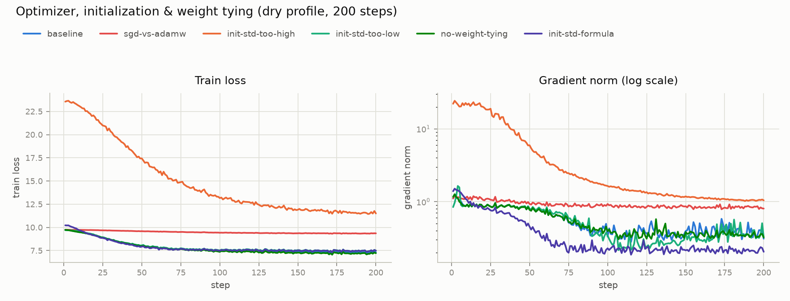

> Draft scaffold. The prose below is a placeholder — this file exists so the
> figure path (`make_figures.py` → `femtochat/<post>/output/figures/` →
> `assets/img/femtochat/<post>/` → this post) is proven before the real post is
> written. The numbers live in
> `femtochat/xxxx-xx-xx-pretraining-ablations-of-femtochat/REPORT.md`.

## Introduction

Each run changes one setting against a matched control, and the plots are
regenerated from the training event files by `make_figures.py`.

## Optimizer and initialization

## Closing

Placeholder.
