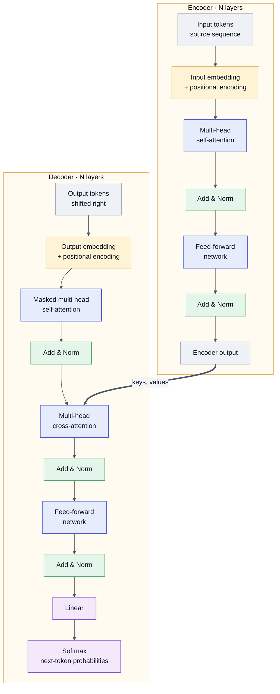
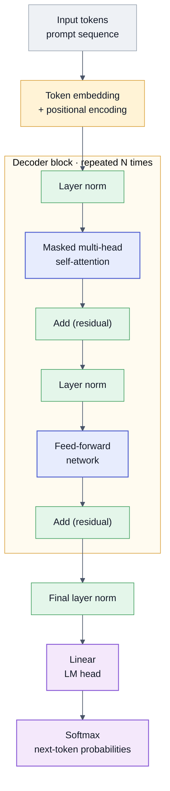

This post is about the architecture of **Femtochat**. I aim to build a model that can follow simple instructions and generate coherent answers in English. The architecture of **Femtochat** is based on the Transformer architecture introduced by [Vaswani et al.][attention-is-all-you-need-arxiv]. The original Transformer architecture is a sequence-to-sequence model and consists of an Encoder and a Decoder that are connected by cross-attention layers in the Decoder. The architecture is shown below.

Most modern language models predict one token at a time and not a sequence. For this, they only use the Decoder part of the original Transformer architecture. The models predict the next token $t_{i+1}$ based on the sequence of preceding tokens $(t_1, \ldots, t_i)$. This is called autoregressive generation. Their self-attention mechanism lets the embedding $e_i$ of token $t_i$ attend only to the embeddings $e_1, \ldots, e_i$ of earlier tokens and itself. This is achieved by causal masking. Hence, most modern language models are autoregressive causal Decoder models. The architecture is shown below.

Modern language models use many [variants][llm-architecture-gallery] of this architecture. In a first iteration, **Femtochat** uses the classical GPT-2-style architecture that was also used in [NanoGPT][nanogpt-github] and [Nanochat][nanochat-github].

[nanogpt-github]: https://github.com/karpathy/nanoGPT
[nanochat-github]: https://github.com/karpathy/nanochat/
[attention-is-all-you-need-arxiv]: https://arxiv.org/abs/1706.03762
[llm-architecture-gallery]: https://sebastianraschka.com/llm-architecture-gallery/
