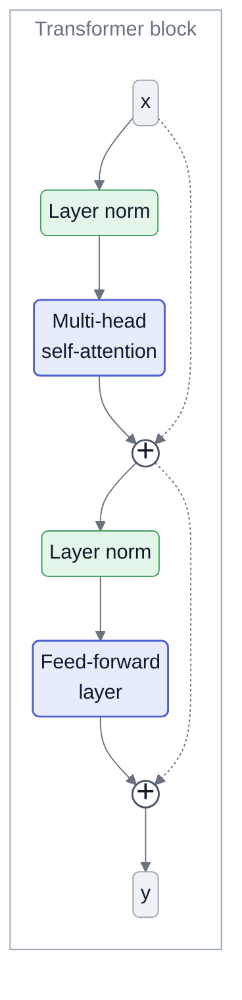
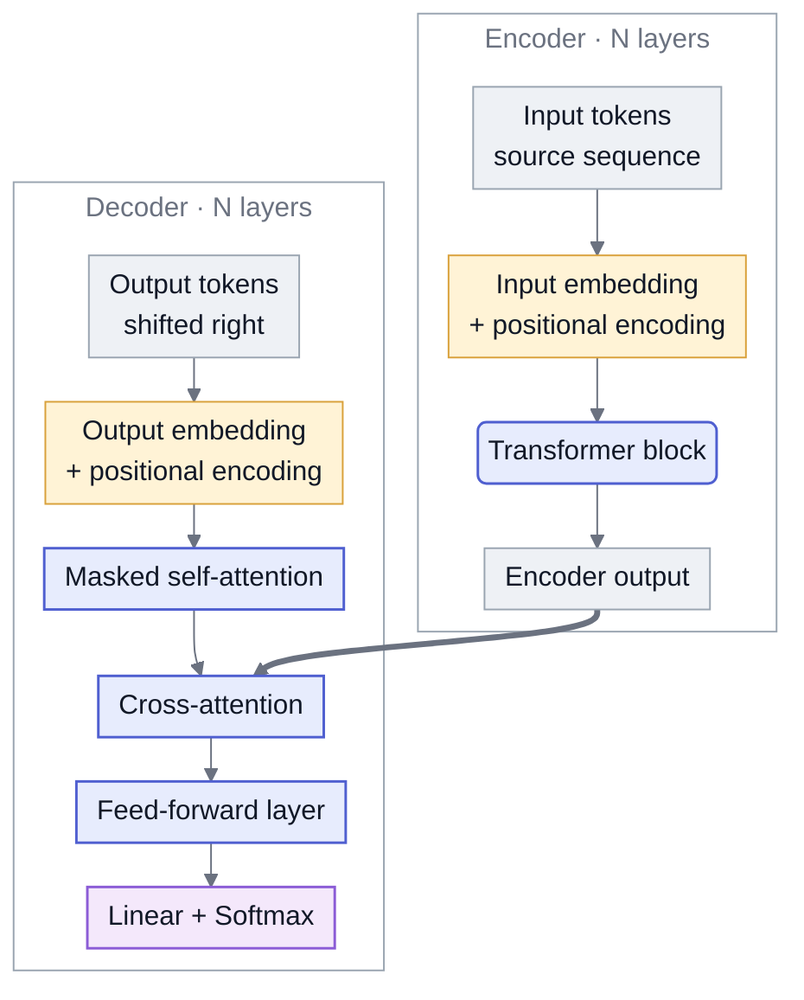
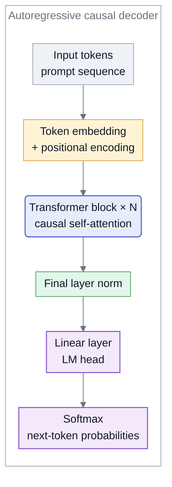

## Introduction
This post is about the architecture of **Femtochat**. In this post I write about the high-level architecture of the model. In later posts I will show concrete implementations and training runs of the model.

## Starting point for language models: Transformer architecture
Language models see text as a sequence of tokens $(t_1, \ldots, t_N)$. LLMs map each token $t_i$ to an embedding vector $e_i$ and turn a token sequence $(t_1, \ldots, t_N)$ into an embedding sequence $(e_1, \ldots, e_N)$.

As with most modern LLMs, **Femtochat** is based on the Transformer architecture introduced by [Vaswani et al.][attention-is-all-you-need-arxiv]. A Transformer stacks multiple Transformer blocks. Each block takes a sequence of input embeddings $e_1, \ldots, e_N$ and outputs a transformed sequence of embeddings of the same length.

Inside a block, the embeddings pass through an attention layer that computes how much each token attends to the others and updates the representations using that context. Comparing tokens within one sequence gives self-attention, while comparing tokens across two sequences gives cross-attention.

The updated embeddings then pass through a feed-forward layer that processes each token position separately. Residual connections and layer normalization help keep training stable, with layer norm placed before each sub-block in the diagram below.

The original Transformer architecture was introduced to enhance machine translation and is a sequence-to-sequence model.

It consists of two stacks of Transformer layers called Encoder and Decoder. The Encoder uses the form of self-attention described above. The Decoder only compares each embedding with preceding embeddings and itself, i.e. $e_i$ with $e_1, \ldots, e_i$. This is achieved by masking all the other embeddings and is called causal self-attention.

The token embeddings in both are supplemented by positional embeddings that encode the position of the token in the sequence. During training, the Decoder receives target tokens shifted right by one step so it predicts the next token at each position.

Encoder and Decoder are connected by a cross-attention layer. Hence, the sequence of the Decoder attends to the output sequence of the Encoder so the Decoder can use information from the input sequence while generating each output token. The original Transformer architecture is shown below.

## Default model for language generation: autoregressive causal Decoder
Most modern language models generate one token at a time rather than mapping one full sequence to another. For this, they use only the causal Decoder side of the original Transformer. Given preceding tokens $(t_1, \ldots, t_i)$, each embedding attends only to earlier tokens and itself to predict the next token $t_{i+1}$. This step-by-step prediction is called autoregressive generation. To get next-token predictions, a linear layer (the LM head) projects the transformed embedding of $t_i$ to the size of the token vocabulary $V$ (the total number of tokens in the tokenizer). A Softmax layer then turns those scores into a probability distribution $p(t_{i+1} \mid t_1, \ldots, t_i)$.

The architecture is shown below.

## Closing and next steps
Modern language models use many [variants][llm-architecture-gallery] of this architecture. In a first iteration, **Femtochat** uses the classical GPT-2-style architecture that was also used in [NanoGPT][nanogpt-github] and [Nanochat][nanochat-github]. I will try modern improvements like RoPE, RMSNorm, and SwiGLU later, once the baseline is up and running.

[nanogpt-github]: https://github.com/karpathy/nanoGPT
[nanochat-github]: https://github.com/karpathy/nanochat/
[attention-is-all-you-need-arxiv]: https://arxiv.org/abs/1706.03762
[llm-architecture-gallery]: https://sebastianraschka.com/llm-architecture-gallery/
